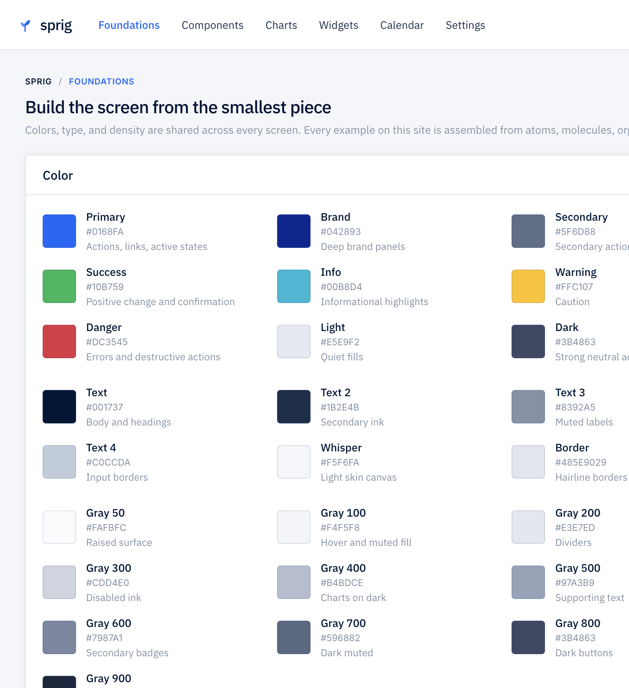
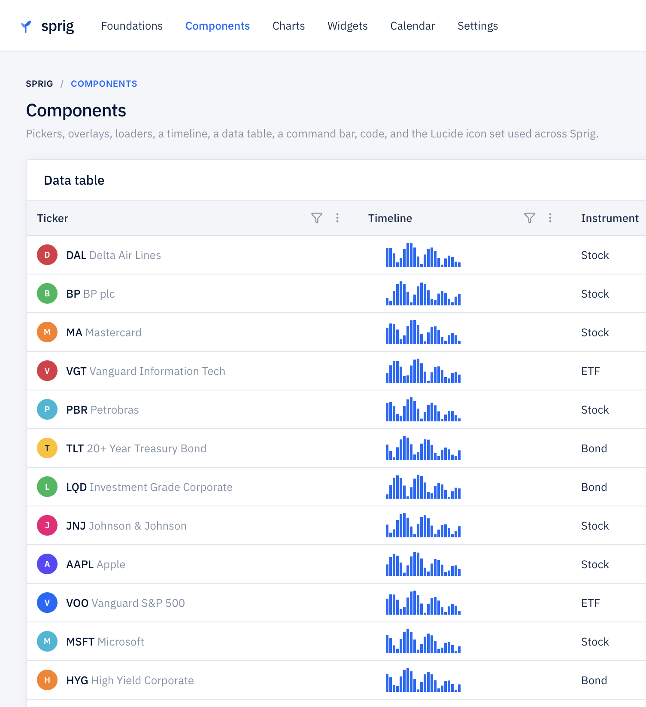
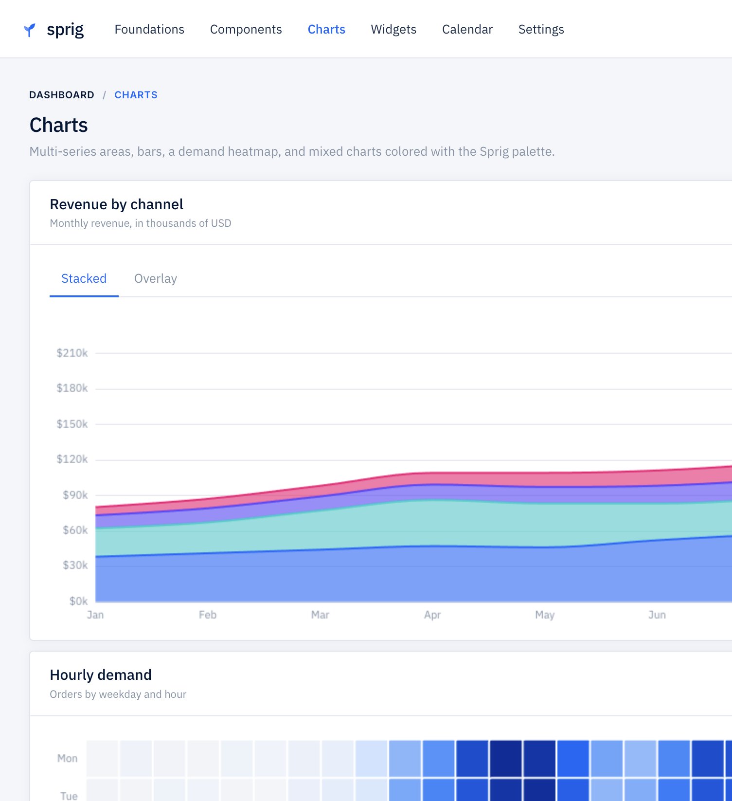
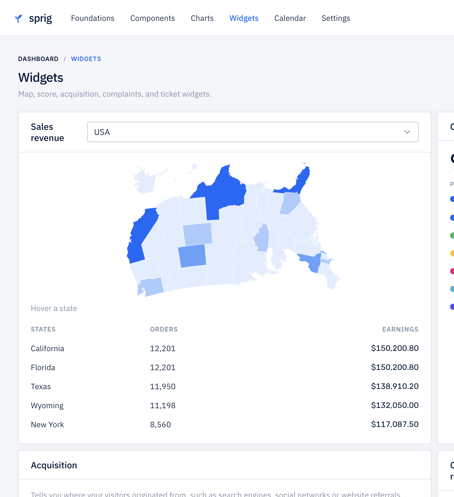
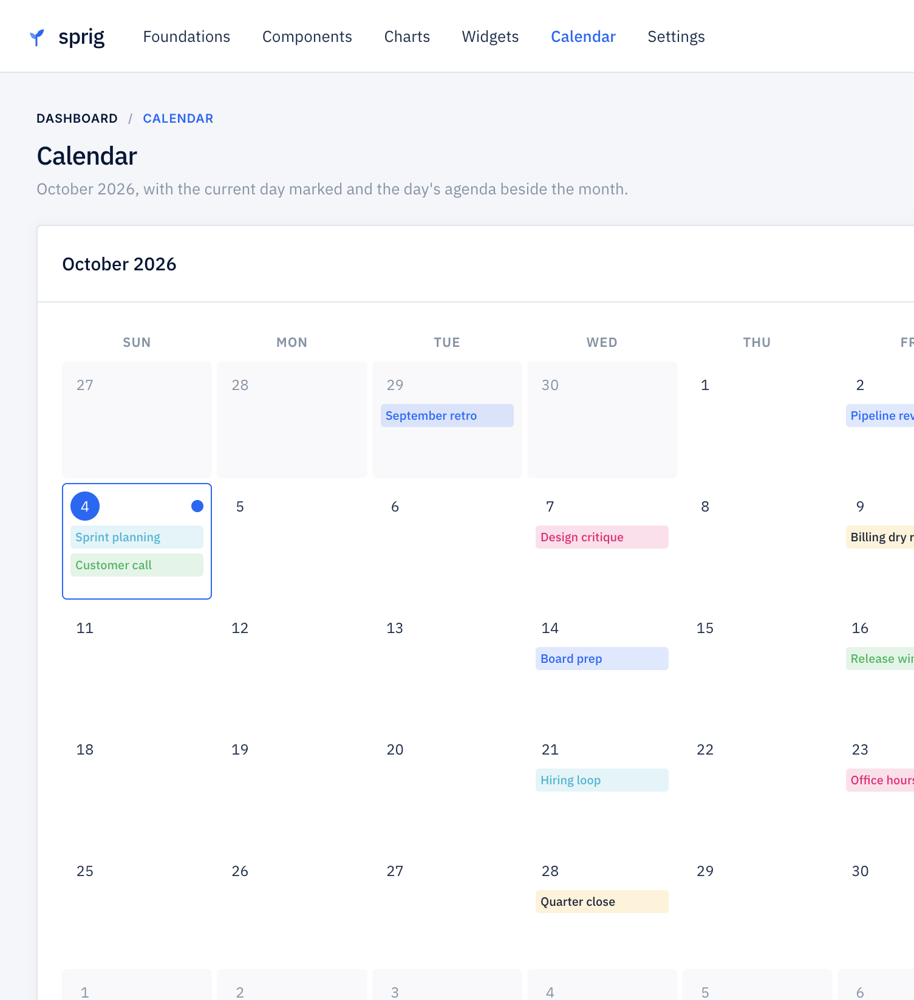
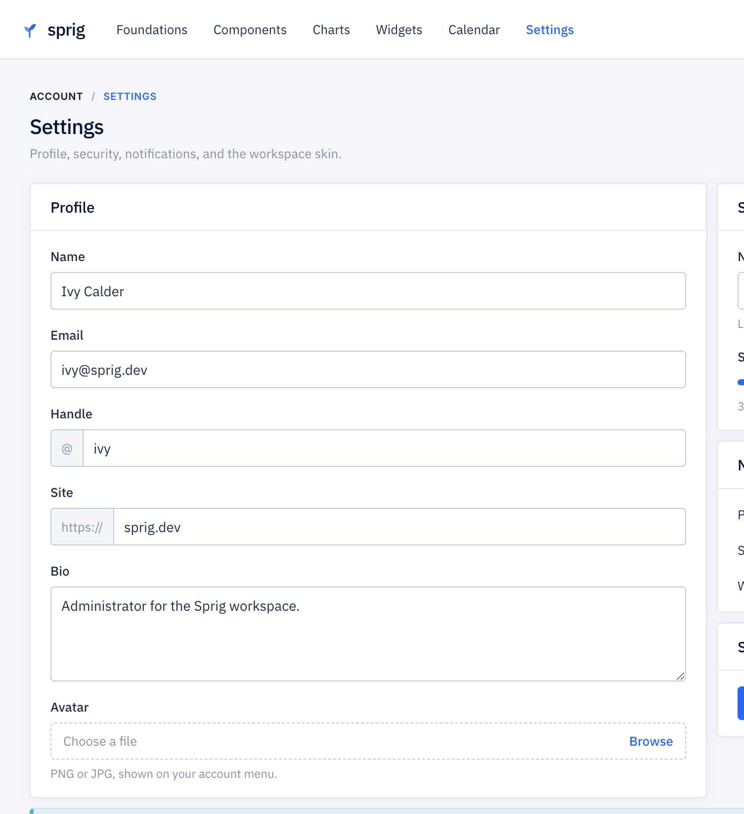
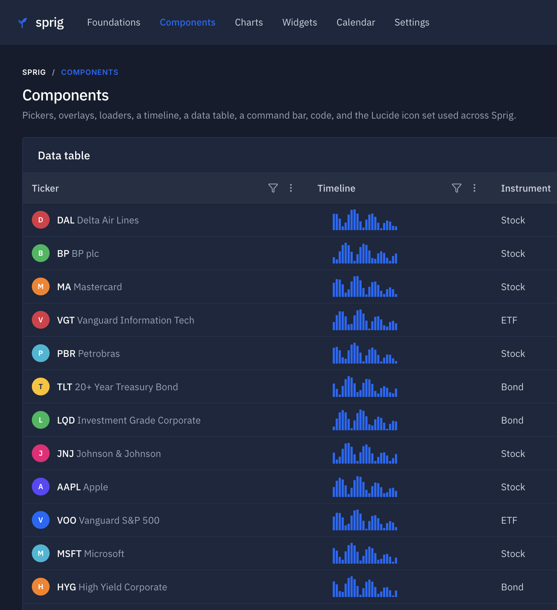

# Sprig

Sprig is a React design system for dashboards, apps, and pages. Color, type, and density are shared across atoms, molecules, organisms, charts, widgets, and full-page examples. The components are built with Radix primitives and Tailwind CSS.



## Install

```bash
pnpm add sprig-design-system
```

Peer dependencies: `react` and `react-dom` 19 or newer, and Tailwind CSS 4.

## Setup

Add the fonts, tokens, and a Tailwind source scan to your global stylesheet. Tailwind does not scan `node_modules` unless you point it at the package.

```css
@import "tailwindcss";
@import "sprig-design-system/fonts.css";
@import "sprig-design-system/styles.css";
@source "../node_modules/sprig-design-system/dist";
```

Wrap the app in `ThemeProvider`. The boot script applies the saved skin before paint. Light is the default.

```tsx
import { ThemeProvider, themeBootScript, TooltipProvider } from "sprig-design-system";

export default function RootLayout({ children }: { children: React.ReactNode }) {
  return (
    <html lang="en" data-theme="light" suppressHydrationWarning>
      <body>
        <script dangerouslySetInnerHTML={{ __html: themeBootScript }} />
        <ThemeProvider>
          <TooltipProvider>{children}</TooltipProvider>
        </ThemeProvider>
      </body>
    </html>
  );
}
```

Sprig links render an `<a>` unless you pass your router's link component. In a Next.js app, provide the link and the current path so navigation stays client-side.

```tsx
"use client";

import NextLink from "next/link";
import { usePathname, useRouter } from "next/navigation";
import {
  SprigLinkProvider,
  SprigNavigationProvider,
  type SprigLinkProps,
} from "sprig-design-system";

function AppLink({ href, ...props }: SprigLinkProps) {
  return <NextLink href={href} {...props} />;
}

export function SprigRouting({ children }: { children: React.ReactNode }) {
  const pathname = usePathname();
  const router = useRouter();
  return (
    <SprigLinkProvider linkComponent={AppLink}>
      <SprigNavigationProvider pathname={pathname} onNavigate={(href) => router.push(href)}>
        {children}
      </SprigNavigationProvider>
    </SprigLinkProvider>
  );
}
```

## Components

Import controls, layout, and theme helpers from the package root. This entry does not load ECharts.

```tsx
import { Button, Header, DataTable } from "sprig-design-system";
```

`Header` takes `nav` and `user`. `DataTable` and `CalendarMonth` take their rows and events as props.



## Charts

```tsx
import { AreaChart } from "sprig-design-system/charts";
```

Area, bar, combo, heatmap, and radar charts read the active skin. `echarts` is installed with the package and is only loaded from this entry.



## Widgets

```tsx
import { RevenueMap, SatisfactionScore } from "sprig-design-system/widgets";
```

The map, satisfaction score, acquisition panel, complaints panel, ticket status, activity feed, and holdings table live here. Pass your own series and rows. Insight cards that draw charts load the charts entry.



## Examples

```tsx
import { DashboardShell, ChartsGalleryTemplate } from "sprig-design-system/examples";
```

Page templates and the fixture data behind this guide are available when you want a starting screen. `DashboardShell` renders the header, command bar, and footer used on the example pages.





## Skins

Light and dark. `ThemeProvider` stores the choice in `localStorage` under `sprig-theme` and sets `data-theme` on the document element.



Fonts are IBM Plex Sans for interface text, Rubik for metrics, and Inter for eyebrows, badges, and breadcrumbs. `sprig-design-system/fonts.css` loads them.

## Scripts

From this repo:

```bash
pnpm dev
pnpm storybook
pnpm test
pnpm lint
pnpm typecheck
pnpm build
pnpm changeset
```

`pnpm changeset` records a version bump. On `main`, GitHub Actions opens the version pull request and publishes `sprig-design-system` to npm with provenance. Versions stay on 0.x while the public API is settling.

The first publish needs a one-time setup on your npm account: create trusted publishing for `sprig-design-system` and attach the `GnosisAssembler/sprig` GitHub repository. The release job uses GitHub's OIDC token, so the repo does not store an npm token.

## License

MIT
